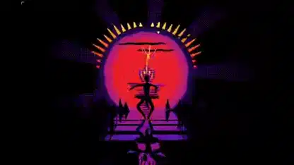

<!-- Generated by scripts/build.py. -->

# バレリーナ

[一覧に戻る](https://github.com/VibeClip/awesome-fable-5-2-videos/blob/main/README.ja.md)

**[▶ 本編](https://video.twimg.com/amplify_video/2123971926330941440/vid/avc1/412x270/FBsLVwsjJT-k1uy1.mp4?tag=29)** · [元の投稿](https://x.com/JungleSilicon/status/2123972106073571812)

[JungleSilicon](https://x.com/JungleSilicon) · 3:13 · 2026-11-21

作者はFable 5.2でピクセルアート風のガウシアンスプラット作品を制作した。

## 公開プロンプト

公開プロンプトは未登録です。

出典と確認情報

- モデル表記の根拠: 元の投稿にモデル名の記載あり
- 投稿のアクセス確認日: 2026-11-21 — 投稿にアクセス可能

投稿のアクセス確認と動画生成の再現は別です。生成やレンダリングを独立して再現していません。

[ライセンスとメディアの権利](https://github.com/VibeClip/awesome-fable-5-2-videos/blob/main/docs/MEDIA-RIGHTS.md)

