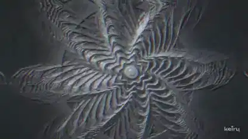

<!-- Generated by scripts/build.py. -->

# 乱数シードで作ったインダストリアルなドラムンベースと浮き彫り映像

[一覧に戻る](https://github.com/VibeClip/awesome-fable-5-2-videos/blob/main/README.ja.md)

**[▶ 本編](https://video.twimg.com/amplify_video/2120532142832934912/vid/avc1/1920x1080/pRXtEmq3PKIg5qOf.mp4?tag=29)** · [元の投稿](https://x.com/keiru_ai/status/2120532609625424195)

[keiru_ai](https://x.com/keiru_ai) · 1:36 · 2026-11-11

作者はClaude CodeのFable 5.2、乱数シードによる音の生成、Three.jsの映像を使ったと説明しています。

## 公開プロンプト

公開プロンプトは未登録です。

出典と確認情報

- モデル表記の根拠: 元の投稿にモデル名の記載あり
- 投稿のアクセス確認日: 2026-11-13 — 投稿にアクセス可能

投稿のアクセス確認と動画生成の再現は別です。生成やレンダリングを独立して再現していません。

[ライセンスとメディアの権利](https://github.com/VibeClip/awesome-fable-5-2-videos/blob/main/docs/MEDIA-RIGHTS.md)

