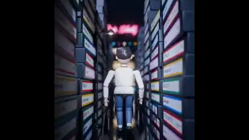

<!-- Generated by scripts/build.py. -->

# Blenderで作った1980年代風ミュージックビデオ

[一覧に戻る](https://github.com/VibeClip/awesome-fable-5-2-videos/blob/main/README.ja.md)

**[▶ 本編](https://video.twimg.com/amplify_video/2120947367142981632/vid/avc1/2160x2160/JErOSxM1cooLCIA5.mp4?tag=29)** · [元の投稿](https://x.com/kevin_t_ngo/status/2120948511038648596)

[kevin_t_ngo](https://x.com/kevin_t_ngo) · 2:18 · 2026-11-12

作者は映像をFable 5.2がコードで作り、Pythonで動かしてBlenderで描画したと説明しています。

## 公開プロンプト

公開プロンプトは未登録です。

出典と確認情報

- モデル表記の根拠: 元の投稿にモデル名の記載あり
- 投稿のアクセス確認日: 2026-11-13 — 投稿にアクセス可能

投稿のアクセス確認と動画生成の再現は別です。生成やレンダリングを独立して再現していません。

[ライセンスとメディアの権利](https://github.com/VibeClip/awesome-fable-5-2-videos/blob/main/docs/MEDIA-RIGHTS.md)

