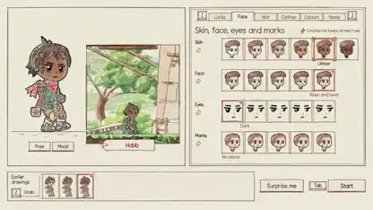

<!-- Generated by scripts/build.py. -->

# 『Valsera』コードで描いた横スクロールRPG

[一覧に戻る](https://github.com/VibeClip/awesome-fable-5-2-videos/blob/main/README.ja.md)

**[▶ 本編](https://video.twimg.com/amplify_video/2121679674543890432/vid/avc1/1920x1080/BOfROoc3Hogm0aWs.mp4?tag=29)** · [元の投稿](https://x.com/kevin_t_ngo/status/2121701020598415465)

[kevin_t_ngo](https://x.com/kevin_t_ngo) · 1:45 · 2026-11-14

作者によると、Fable 5.2が画像モデルや既製素材を使わずに絵を描画。イラスト調の世界でキャラクター設定、村、戦闘を見せ、返信に体験版を載せています。

[元の投稿](https://x.com/kevin_t_ngo/status/2121701022087475398)

## 公開プロンプト

公開プロンプトは未登録です。

出典と確認情報

- モデル表記の根拠: 元の投稿にモデル名の記載あり
- 投稿のアクセス確認日: 2026-11-14 — 投稿にアクセス可能

投稿のアクセス確認と動画生成の再現は別です。生成やレンダリングを独立して再現していません。

[ライセンスとメディアの権利](https://github.com/VibeClip/awesome-fable-5-2-videos/blob/main/docs/MEDIA-RIGHTS.md)

