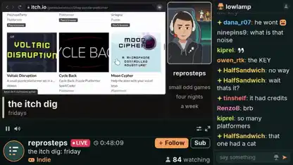

<!-- Generated by scripts/build.py. -->

# 架空の配信者が実在するパズルアクションゲームを遊ぶ

[一覧に戻る](https://github.com/VibeClip/awesome-fable-5-2-videos/blob/main/README.ja.md)

**[▶ 本編](https://video.twimg.com/amplify_video/2121780079818911744/vid/avc1/3840x2160/Si2gJV-V3_k7SLyG.mp4?tag=29)** · [元の投稿](https://x.com/kevin_t_ngo/status/2121780322106999106)

[kevin_t_ngo](https://x.com/kevin_t_ngo) · 2:08 · 2026-11-15

作者は架空の配信者をFable 5.2で制作。配信者がゲームを探し、markmehereの『Greed II』を遊び、チャットに反応します。ゲームは別の作者による作品です。

## 公開プロンプト

公開プロンプトは未登録です。

出典と確認情報

- モデル表記の根拠: 元の投稿にモデル名の記載あり
- 投稿のアクセス確認日: 2026-11-15 — 投稿にアクセス可能

投稿のアクセス確認と動画生成の再現は別です。生成やレンダリングを独立して再現していません。

[ライセンスとメディアの権利](https://github.com/VibeClip/awesome-fable-5-2-videos/blob/main/docs/MEDIA-RIGHTS.md)

