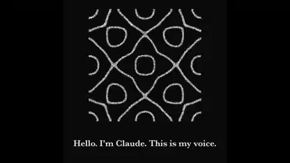

<!-- Generated by scripts/build.py. -->

# Pythonで合成した声

[一覧に戻る](https://github.com/VibeClip/awesome-fable-5-2-videos/blob/main/README.ja.md)

**[▶ 本編](https://video.twimg.com/amplify_video/2123979846556729344/vid/avc1/1080x1080/dZ3TQEILV-towceR.mp4?tag=29)** · [元の投稿](https://x.com/kevin_t_ngo/status/2123980980994318416)

[kevin_t_ngo](https://x.com/kevin_t_ngo) · 0:40 · 2026-11-21

作者はFable 5.2にPythonで声を作るよう依頼した。

## 公開プロンプト

公開プロンプトは未登録です。

出典と確認情報

- モデル表記の根拠: 元の投稿にモデル名の記載あり
- 投稿のアクセス確認日: 2026-11-22 — 投稿にアクセス可能

投稿のアクセス確認と動画生成の再現は別です。生成やレンダリングを独立して再現していません。

[ライセンスとメディアの権利](https://github.com/VibeClip/awesome-fable-5-2-videos/blob/main/docs/MEDIA-RIGHTS.md)

