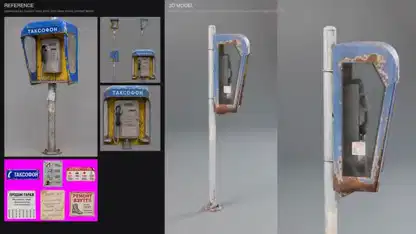

<!-- Generated by scripts/build.py. -->

# 参考画像から作った公衆電話の3Dモデル

[一覧に戻る](https://github.com/VibeClip/awesome-fable-5-2-videos/blob/main/README.ja.md)

**[▶ 本編](https://video.twimg.com/amplify_video/2120635020545064960/vid/avc1/1920x1080/gTXdQtNaUG2UIDja.mp4?tag=29)** · [元の投稿](https://x.com/KHvostikk/status/2120635318001180996)

[KHvostikk](https://x.com/KHvostikk) · 0:12 · 2026-11-11

作者はFable 5.2を使った画像から3Dへの変換テストと説明。参考画像の隣で公衆電話のモデルが回転します。他のツールは未公表です。

## 公開プロンプト

公開プロンプトは未登録です。

出典と確認情報

- モデル表記の根拠: 元の投稿にモデル名の記載あり
- 投稿のアクセス確認日: 2026-11-14 — 投稿にアクセス可能

投稿のアクセス確認と動画生成の再現は別です。生成やレンダリングを独立して再現していません。

[ライセンスとメディアの権利](https://github.com/VibeClip/awesome-fable-5-2-videos/blob/main/docs/MEDIA-RIGHTS.md)

