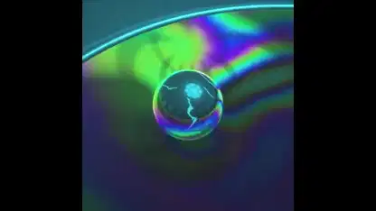

<!-- Generated by scripts/build.py. -->

# 単一のGLSLシェーダーで描く虹色のガラス

[一覧に戻る](https://github.com/VibeClip/awesome-fable-5-2-videos/blob/main/README.ja.md)

**[▶ 本編](https://video.twimg.com/amplify_video/2120689574079078400/vid/avc1/1080x1080/GQ2VNJwrUh4fKSoc.mp4?tag=29)** · [元の投稿](https://x.com/kloss_xyz/status/2120689622124798324)

[kloss_xyz](https://x.com/kloss_xyz) · 0:30 · 2026-11-12

作者はPythonで動きを付け、単一のGLSLシェーダーで描画した。音はサンプルライブラリの録音をPythonでミックスした。

[元の投稿](https://x.com/kloss_xyz/status/2120691788700910046)

## 公開プロンプト

作者が下記のリンクでプロンプトを公開しています。参考素材や追加指示と合わせて元の文脈を確認してください。

[作者の公開プロンプトを読む](https://x.com/kloss_xyz/status/2120691788700910046)

出典と確認情報

- モデル表記の根拠: 元の投稿にモデル名の記載あり
- 投稿のアクセス確認日: 2026-11-16 — 投稿にアクセス可能

投稿のアクセス確認と動画生成の再現は別です。生成やレンダリングを独立して再現していません。

[ライセンスとメディアの権利](https://github.com/VibeClip/awesome-fable-5-2-videos/blob/main/docs/MEDIA-RIGHTS.md)

