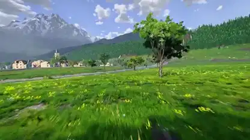

<!-- Generated by scripts/build.py. -->

# Valle Morta：山岳サバイバルゲーム

[一覧に戻る](https://github.com/VibeClip/awesome-fable-5-2-videos/blob/main/README.ja.md)

**[▶ 本編](https://video.twimg.com/amplify_video/2121932247418781696/vid/avc1/3840x2160/pD4ekVQZGGrOVgAh.mp4?tag=29)** · [元の投稿](https://x.com/LexnLin/status/2121934071429468543)

[LexnLin](https://x.com/LexnLin) · 0:45 · 2026-11-15

開発者はFable 5.2を主に使い、Opus 5.5とSonnetをサブエージェントとして使用。ゲームはThree.js、一部のモデルはBlenderで制作し、音楽や一部の効果音は外部音源を使用した。

[元の投稿](https://x.com/LexnLin/status/2121934075229303036)

[元の投稿](https://x.com/LexnLin/status/2121934078408597998)

[元の投稿](https://x.com/LexnLin/status/2122012749664325903)

## 公開プロンプト

公開プロンプトは未登録です。

出典と確認情報

- モデル表記の根拠: 元の投稿にモデル名の記載あり
- 投稿のアクセス確認日: 2026-11-16 — 投稿にアクセス可能

投稿のアクセス確認と動画生成の再現は別です。生成やレンダリングを独立して再現していません。

[ライセンスとメディアの権利](https://github.com/VibeClip/awesome-fable-5-2-videos/blob/main/docs/MEDIA-RIGHTS.md)

