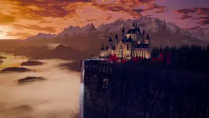

<!-- Generated by scripts/build.py. -->

# 断崖の古城

[一覧に戻る](https://github.com/VibeClip/awesome-fable-5-2-videos/blob/main/README.ja.md)

**[▶ 本編](https://video.twimg.com/amplify_video/2122110502281134081/vid/avc1/3840x2160/Oz48CbKmSwgFShHt.mp4?tag=29)** · [元の投稿](https://x.com/LexnLin/status/2122112228522623459)

[LexnLin](https://x.com/LexnLin) · 0:45 · 2026-11-15

作者はFable 5.2でBlender用のPythonを書き、形状やテクスチャも制作した。

## 公開プロンプト

公開プロンプトは未登録です。

出典と確認情報

- モデル表記の根拠: 元の投稿にモデル名の記載あり
- 投稿のアクセス確認日: 2026-11-16 — 投稿にアクセス可能

投稿のアクセス確認と動画生成の再現は別です。生成やレンダリングを独立して再現していません。

[ライセンスとメディアの権利](https://github.com/VibeClip/awesome-fable-5-2-videos/blob/main/docs/MEDIA-RIGHTS.md)

