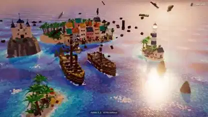

<!-- Generated by scripts/build.py. -->

# 波までブロックでできた海賊ショート

[一覧に戻る](https://github.com/VibeClip/awesome-fable-5-2-videos/blob/main/README.ja.md)

**[▶ 本編](https://video.twimg.com/amplify_video/2121066008483913728/vid/avc1/1920x1080/kzRTU-ZlEwqnem5b.mp4?tag=29)** · [元の投稿](https://x.com/loktar00/status/2121066943662743624)

[loktar00](https://x.com/loktar00) · 0:50 · 2026-11-13

作者は海賊の映像をFable 5.2で作り、波の一つ一つを動くブロックの組み合わせで表現したと説明しています。

## 公開プロンプト

公開プロンプトは未登録です。

出典と確認情報

- モデル表記の根拠: 元の投稿にモデル名の記載あり
- 投稿のアクセス確認日: 2026-11-13 — 投稿にアクセス可能

投稿のアクセス確認と動画生成の再現は別です。生成やレンダリングを独立して再現していません。

[ライセンスとメディアの権利](https://github.com/VibeClip/awesome-fable-5-2-videos/blob/main/docs/MEDIA-RIGHTS.md)

