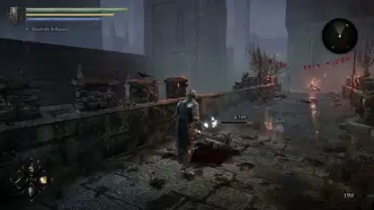

<!-- Generated by scripts/build.py. -->

# Three.jsで作ったダークファンタジーのブラウザーゲーム

[一覧に戻る](https://github.com/VibeClip/awesome-fable-5-2-videos/blob/main/README.ja.md)

**[▶ 本編](https://video.twimg.com/ext_tw_video/2121896455816548352/pu/vid/avc1/1280x720/RU6LuiJL3vKv0LKs.mp4?tag=12)** · [元の投稿](https://x.com/MengTo/status/2121896633848017145)

[MengTo](https://x.com/MengTo) · 1:39 · 2026-11-15

作者はClaude CodeでFable 5.2とOpus 5.5を使用し、素材にSeedream 5.0 ProとTripoを使用。マップや雰囲気のある風景、ボス戦を映しています。

[元の投稿](https://x.com/MengTo/status/2121896684653576574)

## 公開プロンプト

作者が下記のリンクでプロンプトを公開しています。参考素材や追加指示と合わせて元の文脈を確認してください。

[作者の公開プロンプトを読む](https://x.com/MengTo/status/2121896842300686560)

出典と確認情報

- モデル表記の根拠: 元の投稿にモデル名の記載あり
- 投稿のアクセス確認日: 2026-11-15 — 投稿にアクセス可能

投稿のアクセス確認と動画生成の再現は別です。生成やレンダリングを独立して再現していません。

[ライセンスとメディアの権利](https://github.com/VibeClip/awesome-fable-5-2-videos/blob/main/docs/MEDIA-RIGHTS.md)

