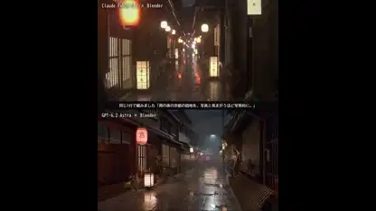

<!-- Generated by scripts/build.py. -->

# Blenderで描く雨の夜の京都の路地

[一覧に戻る](https://github.com/VibeClip/awesome-fable-5-2-videos/blob/main/README.ja.md)

**[▶ 本編](https://video.twimg.com/amplify_video/2123403402856353792/vid/avc1/480x562/eBUiSAw1Wp3mANi0.mp4?tag=29)** · [元の投稿](https://x.com/mizugame_22/status/2123403431167844544)

[mizugame_22](https://x.com/mizugame_22) · 0:13 · 2026-11-19

上が Fable 5.2、下が GPT-6.2 Astra。両方とも Blender Cycles、外部の CC0 素材、別の AI によるレビューを使用。投稿では冒頭約13秒を上下に並べている。

## 公開プロンプト

作者が公開した原文のまま掲載。必要な入力や文脈は元の投稿を参照してください。

> 雨の夜の京都の路地を、写真と見まがうほど写実的に。

[作者の公開プロンプトを読む](https://x.com/mizugame_22/status/2123403431167844544)

出典と確認情報

- モデル表記の根拠: 元の投稿にモデル名の記載あり
- 投稿のアクセス確認日: 2026-11-24 — 投稿にアクセス可能

投稿のアクセス確認と動画生成の再現は別です。生成やレンダリングを独立して再現していません。

[ライセンスとメディアの権利](https://github.com/VibeClip/awesome-fable-5-2-videos/blob/main/docs/MEDIA-RIGHTS.md)

