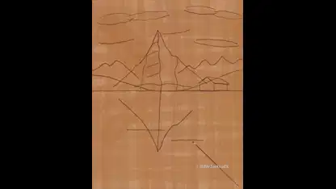

<!-- Generated by scripts/build.py. -->

# 下描きから水面の反射まで描くスイスの湖

[一覧に戻る](https://github.com/VibeClip/awesome-fable-5-2-videos/blob/main/README.ja.md)

**[▶ 本編](https://video.twimg.com/amplify_video/2120473115025088512/vid/avc1/1080x1350/smQxijj1Yis_3zAa.mp4?tag=29)** · [元の投稿](https://x.com/MrTacticalX/status/2120473175158849884)

[MrTacticalX](https://x.com/MrTacticalX) · 1:00 · 2026-11-11

作者はスイスの湖を題材にした油絵としてFable 5.2の成果を紹介しています。描画ツールは明記していません。

## 公開プロンプト

公開プロンプトは未登録です。

出典と確認情報

- モデル表記の根拠: 元の投稿にモデル名の記載あり
- 投稿のアクセス確認日: 2026-11-13 — 投稿にアクセス可能

投稿のアクセス確認と動画生成の再現は別です。生成やレンダリングを独立して再現していません。

[ライセンスとメディアの権利](https://github.com/VibeClip/awesome-fable-5-2-videos/blob/main/docs/MEDIA-RIGHTS.md)

