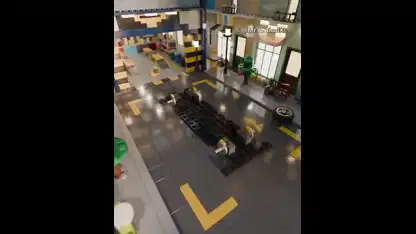

<!-- Generated by scripts/build.py. -->

# ミニチュアの街を走るブロック製スーパーカー

[一覧に戻る](https://github.com/VibeClip/awesome-fable-5-2-videos/blob/main/README.ja.md)

**[▶ 本編](https://video.twimg.com/amplify_video/2120842640656642048/vid/avc1/1080x1350/FQ9QjhiAQKuKCDWV.mp4?tag=29)** · [元の投稿](https://x.com/MrTacticalX/status/2120842705395966254)

[MrTacticalX](https://x.com/MrTacticalX) · 0:29 · 2026-11-12

作者は501ピースのブロック製の車を、3体のFable 5.2エージェントで制作したと説明しています。

## 公開プロンプト

公開プロンプトは未登録です。

出典と確認情報

- モデル表記の根拠: 元の投稿にモデル名の記載あり
- 投稿のアクセス確認日: 2026-11-13 — 投稿にアクセス可能

投稿のアクセス確認と動画生成の再現は別です。生成やレンダリングを独立して再現していません。

[ライセンスとメディアの権利](https://github.com/VibeClip/awesome-fable-5-2-videos/blob/main/docs/MEDIA-RIGHTS.md)

