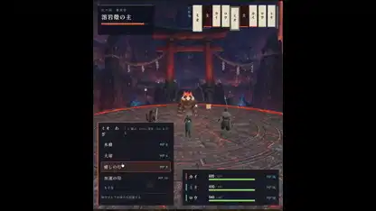

<!-- Generated by scripts/build.py. -->

# 行動順が見えるブラウザーのターン制バトル

[一覧に戻る](https://github.com/VibeClip/awesome-fable-5-2-videos/blob/main/README.ja.md)

**[▶ 本編](https://video.twimg.com/amplify_video/2120850004445470720/vid/avc1/1492x1660/RnGC-9muW2GDFzf5.mp4?tag=29)** · [元の投稿](https://x.com/nesaivideo/status/2120851458421821675)

[nesaivideo](https://x.com/nesaivideo) · 3:13 · 2026-11-12

作者はFable 5.2で4体の3Dキャラクター、背景、行動順が見えるブラウザーデモを制作。戦闘中も操作画面が見える録画です。

## 公開プロンプト

公開プロンプトは未登録です。

出典と確認情報

- モデル表記の根拠: 元の投稿にモデル名の記載あり
- 投稿のアクセス確認日: 2026-11-15 — 投稿にアクセス可能

投稿のアクセス確認と動画生成の再現は別です。生成やレンダリングを独立して再現していません。

[ライセンスとメディアの権利](https://github.com/VibeClip/awesome-fable-5-2-videos/blob/main/docs/MEDIA-RIGHTS.md)

