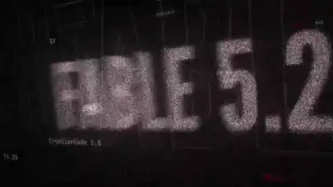

<!-- Generated by scripts/build.py. -->

# 赤と黒のモーショングラフィックスで描くFableの自己紹介

[一覧に戻る](https://github.com/VibeClip/awesome-fable-5-2-videos/blob/main/README.ja.md)

**[▶ 本編](https://video.twimg.com/amplify_video/2120094895734222848/vid/avc1/1920x1080/iPkDdsxiXoDx45PI.mp4?tag=29)** · [元の投稿](https://x.com/noel_ai_lab/status/2120095087397151229)

[noel_ai_lab](https://x.com/noel_ai_lab) · 0:43 · 2026-11-10

作者によると、Fable 5.2が映像をコードで作り、音楽にはMCP経由でSunoを使用。タイトルカード、網点調の絵、大きな日本語文字を組み合わせています。

## 公開プロンプト

公開プロンプトは未登録です。

出典と確認情報

- モデル表記の根拠: 元の投稿にモデル名の記載あり
- 投稿のアクセス確認日: 2026-11-15 — 投稿にアクセス可能

投稿のアクセス確認と動画生成の再現は別です。生成やレンダリングを独立して再現していません。

[ライセンスとメディアの権利](https://github.com/VibeClip/awesome-fable-5-2-videos/blob/main/docs/MEDIA-RIGHTS.md)

