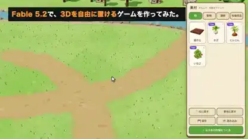

<!-- Generated by scripts/build.py. -->

# 遊べる3D牧場づくりゲーム

[一覧に戻る](https://github.com/VibeClip/awesome-fable-5-2-videos/blob/main/README.ja.md)

**[▶ 本編](https://video.twimg.com/amplify_video/2121452791164264448/vid/avc1/1920x1080/jkb1uVrk_B6bJHRN.mp4?tag=29)** · [元の投稿](https://x.com/onofumi_AI/status/2121452857576878318)

[onofumi_AI](https://x.com/onofumi_AI) · 0:32 · 2026-11-14

作者はゲームのコードにFable 5.2、シーンにThree.js、3DモデルにTripoを使用。動物が歩き回る中、プレイヤーは柵や小物を置いて配置を変えられます。

[元の投稿](https://x.com/onofumi_AI/status/2121452953022202351)

## 公開プロンプト

公開プロンプトは未登録です。

出典と確認情報

- モデル表記の根拠: 元の投稿にモデル名の記載あり
- 投稿のアクセス確認日: 2026-11-14 — 投稿にアクセス可能

投稿のアクセス確認と動画生成の再現は別です。生成やレンダリングを独立して再現していません。

[ライセンスとメディアの権利](https://github.com/VibeClip/awesome-fable-5-2-videos/blob/main/docs/MEDIA-RIGHTS.md)

