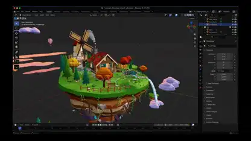

<!-- Generated by scripts/build.py. -->

# Blenderで作る浮遊島

[一覧に戻る](https://github.com/VibeClip/awesome-fable-5-2-videos/blob/main/README.ja.md)

**[▶ 本編](https://video.twimg.com/amplify_video/2120498596738904064/vid/avc1/1920x984/gIo26aM7PmpiuAib.mp4?tag=29)** · [元の投稿](https://x.com/rewind02/status/2120498751773057186)

[rewind02](https://x.com/rewind02) · 0:30 · 2026-11-11

作者によると、Fable 5.2がBlender MCP経由でPythonを使い、物体・マテリアル・照明を生成した。推論強度を変えた2回を比較している。

## 公開プロンプト

作者が公開した原文のまま掲載。必要な入力や文脈は元の投稿を参照してください。

> create a low poly floating island scene in blender using blender mcp

[作者の公開プロンプトを読む](https://x.com/rewind02/status/2120498751773057186)

出典と確認情報

- モデル表記の根拠: 元の投稿にモデル名の記載あり
- 投稿のアクセス確認日: 2026-11-16 — 投稿にアクセス可能

投稿のアクセス確認と動画生成の再現は別です。生成やレンダリングを独立して再現していません。

[ライセンスとメディアの権利](https://github.com/VibeClip/awesome-fable-5-2-videos/blob/main/docs/MEDIA-RIGHTS.md)

