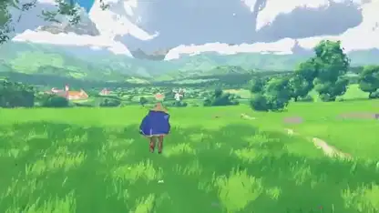

<!-- Generated by scripts/build.py. -->

# 手描き風の谷を歩く旅人

[一覧に戻る](https://github.com/VibeClip/awesome-fable-5-2-videos/blob/main/README.ja.md)

**[▶ 本編](https://video.twimg.com/amplify_video/2121215994832068608/vid/avc1/1920x1080/Si-UOwjUQwtBMraT.mp4?tag=29)** · [元の投稿](https://x.com/rewind02/status/2121216070375612527)

[rewind02](https://x.com/rewind02) · 0:23 · 2026-11-13

作者はFable 5.2、Three.js、Rapierで歩けるシーンを制作。地形は高さマップをもとに作り、旅人はBlenderでモデリングとアニメーションを行っています。

## 公開プロンプト

公開プロンプトは未登録です。

出典と確認情報

- モデル表記の根拠: 元の投稿にモデル名の記載あり
- 投稿のアクセス確認日: 2026-11-15 — 投稿にアクセス可能

投稿のアクセス確認と動画生成の再現は別です。生成やレンダリングを独立して再現していません。

[ライセンスとメディアの権利](https://github.com/VibeClip/awesome-fable-5-2-videos/blob/main/docs/MEDIA-RIGHTS.md)

