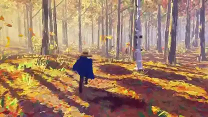

<!-- Generated by scripts/build.py. -->

# 油絵の筆致で描いた歩ける森

[一覧に戻る](https://github.com/VibeClip/awesome-fable-5-2-videos/blob/main/README.ja.md)

**[▶ 本編](https://video.twimg.com/amplify_video/2121575069314875392/vid/avc1/1920x1080/gc-SojMEICkZADf-.mp4?tag=29)** · [元の投稿](https://x.com/rewind02/status/2121575140307706285)

[rewind02](https://x.com/rewind02) · 0:16 · 2026-11-14

作者はThree.jsでFable 5.2と独自のGLSLシェーダーを使い、シーンを筆致として描画。キャラクターと一部の動きには既存素材を使っています。

## 公開プロンプト

公開プロンプトは未登録です。

出典と確認情報

- モデル表記の根拠: 元の投稿にモデル名の記載あり
- 投稿のアクセス確認日: 2026-11-15 — 投稿にアクセス可能

投稿のアクセス確認と動画生成の再現は別です。生成やレンダリングを独立して再現していません。

[ライセンスとメディアの権利](https://github.com/VibeClip/awesome-fable-5-2-videos/blob/main/docs/MEDIA-RIGHTS.md)

