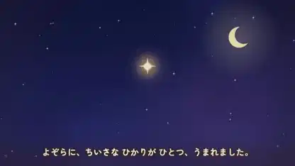

<!-- Generated by scripts/build.py. -->

# 命の大切さを伝える絵本風の短編

[一覧に戻る](https://github.com/VibeClip/awesome-fable-5-2-videos/blob/main/README.ja.md)

**[▶ 本編](https://video.twimg.com/amplify_video/2121449186055073792/vid/avc1/1280x720/AGilyHy2M2HMhJpS.mp4?tag=29)** · [元の投稿](https://x.com/shiomasvision/status/2121449322453860803)

[shiomasvision](https://x.com/shiomasvision) · 1:29 · 2026-11-14

作者はClaude CodeとFable 5.2で幼い子ども向けの物語を制作。月夜から家族の場面へと移り、やわらかな色と字幕でつなぎます。作者は返信で指示の内容を説明しています。

[元の投稿](https://x.com/shiomasvision/status/2121449510316749105)

## 公開プロンプト

作者が公開した原文のまま掲載。必要な入力や文脈は元の投稿を参照してください。

> 5歳くらいの子どもに、命の大切さが自然に伝わる、心が温まる動画を作って

[作者の公開プロンプトを読む](https://x.com/shiomasvision/status/2121449510316749105)

出典と確認情報

- モデル表記の根拠: 元の投稿にモデル名の記載あり
- 投稿のアクセス確認日: 2026-11-15 — 投稿にアクセス可能

投稿のアクセス確認と動画生成の再現は別です。生成やレンダリングを独立して再現していません。

[ライセンスとメディアの権利](https://github.com/VibeClip/awesome-fable-5-2-videos/blob/main/docs/MEDIA-RIGHTS.md)

