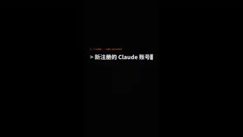

<!-- Generated by scripts/build.py. -->

# 28日間のスクリーンショットをまとめた動く日記

[一覧に戻る](https://github.com/VibeClip/awesome-fable-5-2-videos/blob/main/README.ja.md)

**[▶ 本編](https://video.twimg.com/amplify_video/2121618501471219712/vid/avc1/1080x1920/Gk64QZEmZQz7NdJ0.mp4?tag=29)** · [元の投稿](https://x.com/Stargridcompass/status/2121770161057247242)

[Stargridcompass](https://x.com/Stargridcompass) · 0:28 · 2026-11-15

作者は最初の27日分の投稿画像をFable 5.2に渡し、28日間のシリーズの締めくくりを制作。日数カウンターで各画像をつないでいます。

## 公開プロンプト

公開プロンプトは未登録です。

出典と確認情報

- モデル表記の根拠: 元の投稿にモデル名の記載あり
- 投稿のアクセス確認日: 2026-11-15 — 投稿にアクセス可能

投稿のアクセス確認と動画生成の再現は別です。生成やレンダリングを独立して再現していません。

[ライセンスとメディアの権利](https://github.com/VibeClip/awesome-fable-5-2-videos/blob/main/docs/MEDIA-RIGHTS.md)

