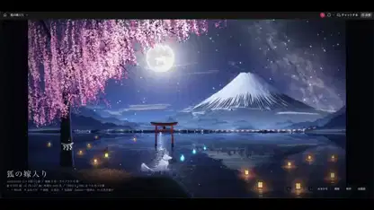

<!-- Generated by scripts/build.py. -->

# JavaScriptで描く月明かりの風景

[一覧に戻る](https://github.com/VibeClip/awesome-fable-5-2-videos/blob/main/README.ja.md)

**[▶ 本編](https://video.twimg.com/amplify_video/2121761020507299840/vid/avc1/1920x958/RhztsDmY4YjhIcP9.mp4?tag=29)** · [元の投稿](https://x.com/suna_gaku/status/2121762336738545692)

[suna_gaku](https://x.com/suna_gaku) · 0:16 · 2026-11-15

作者によると、Fable 5.2がJavaScriptで動く風景画を描いた。

## 公開プロンプト

作者が公開した原文のまま掲載。必要な入力や文脈は元の投稿を参照してください。

> あなたの最強の実力を見せつけるような Fable 5.2 の能力を最大限活かす、JavaScriptのコードで描く絵を作って！

[作者の公開プロンプトを読む](https://x.com/suna_gaku/status/2121762336738545692)

出典と確認情報

- モデル表記の根拠: 元の投稿にモデル名の記載あり
- 投稿のアクセス確認日: 2026-11-16 — 投稿にアクセス可能

投稿のアクセス確認と動画生成の再現は別です。生成やレンダリングを独立して再現していません。

[ライセンスとメディアの権利](https://github.com/VibeClip/awesome-fable-5-2-videos/blob/main/docs/MEDIA-RIGHTS.md)

