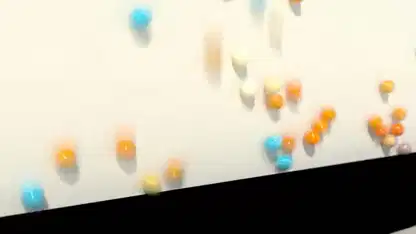

<!-- Generated by scripts/build.py. -->

# Blenderで落下する球が肖像画を作る

[一覧に戻る](https://github.com/VibeClip/awesome-fable-5-2-videos/blob/main/README.ja.md)

**[▶ 本編](https://video.twimg.com/amplify_video/2120051188712476672/vid/avc1/1920x1080/kEwkBi941l86-UIF.mp4?tag=29)** · [元の投稿](https://x.com/Suzacque/status/2120054690029466026)

[Suzacque](https://x.com/Suzacque) · 0:10 · 2026-11-10

作者がプロフィール画像を渡し、Fable 5.2が設計とPythonスクリプトを担当。BlenderのBulletで球の落下を計算し、Cyclesで描画しました。引きの画面で球が肖像を形作ります。

## 公開プロンプト

作者が公開した原文のまま掲載。必要な入力や文脈は元の投稿を参照してください。

> 3Dの物理で、能力を出し切って何か作って

[作者の公開プロンプトを読む](https://x.com/Suzacque/status/2120054690029466026)

出典と確認情報

- モデル表記の根拠: 元の投稿にモデル名の記載あり
- 投稿のアクセス確認日: 2026-11-15 — 投稿にアクセス可能

投稿のアクセス確認と動画生成の再現は別です。生成やレンダリングを独立して再現していません。

[ライセンスとメディアの権利](https://github.com/VibeClip/awesome-fable-5-2-videos/blob/main/docs/MEDIA-RIGHTS.md)

