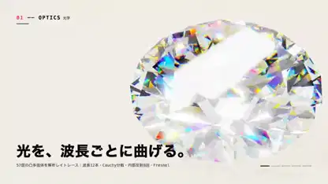

<!-- Generated by scripts/build.py. -->

# 『光と波』屈折から干渉まで

[一覧に戻る](https://github.com/VibeClip/awesome-fable-5-2-videos/blob/main/README.ja.md)

**[▶ 本編](https://video.twimg.com/amplify_video/2120292139250962433/vid/avc1/1280x720/4Eq6Y8beUzyI6wnM.mp4?tag=14)** · [元の投稿](https://x.com/taka_claudecode/status/2120292244737683687)

[taka_claudecode](https://x.com/taka_claudecode) · 0:38 · 2026-11-10

作者によると、Fable 5.2が映像と音楽のコードを作成。宝石の分散、粘菌のような経路、波として進む粒子が登場します。

## 公開プロンプト

公開プロンプトは未登録です。

出典と確認情報

- モデル表記の根拠: 元の投稿にモデル名の記載あり
- 投稿のアクセス確認日: 2026-11-14 — 投稿にアクセス可能

投稿のアクセス確認と動画生成の再現は別です。生成やレンダリングを独立して再現していません。

[ライセンスとメディアの権利](https://github.com/VibeClip/awesome-fable-5-2-videos/blob/main/docs/MEDIA-RIGHTS.md)

