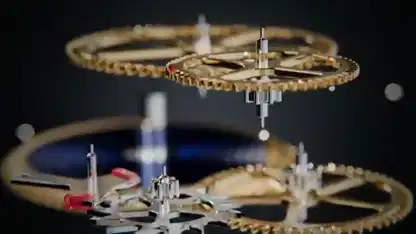

<!-- Generated by scripts/build.py. -->

# 機械式時計のムーブメントを分解して見せる映像

[一覧に戻る](https://github.com/VibeClip/awesome-fable-5-2-videos/blob/main/README.ja.md)

**[▶ 本編](https://video.twimg.com/amplify_video/2119911154638376960/vid/avc1/1920x1080/W-EtG3d_QCeqJjGK.mp4?tag=29)** · [元の投稿](https://x.com/techfren/status/2119911343633682916)

[techfren](https://x.com/techfren) · 0:42 · 2026-11-09

作者によると、Fable 5.2がコードでムーブメントを構築。歯車とプレートが層ごとに分かれ、組み上がった時計へと戻ります。描画ツールは未公表です。

## 公開プロンプト

公開プロンプトは未登録です。

出典と確認情報

- モデル表記の根拠: 元の投稿にモデル名の記載あり
- 投稿のアクセス確認日: 2026-11-14 — 投稿にアクセス可能

投稿のアクセス確認と動画生成の再現は別です。生成やレンダリングを独立して再現していません。

[ライセンスとメディアの権利](https://github.com/VibeClip/awesome-fable-5-2-videos/blob/main/docs/MEDIA-RIGHTS.md)

