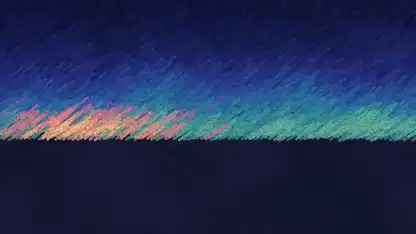

<!-- Generated by scripts/build.py. -->

# 一筆ずつ描くオーロラ

[一覧に戻る](https://github.com/VibeClip/awesome-fable-5-2-videos/blob/main/README.ja.md)

**[▶ 本編](https://video.twimg.com/amplify_video/2121810479509274624/vid/avc1/1280x720/ZXhjmQqQuup48IsG.mp4?tag=14)** · [元の投稿](https://x.com/Terry_Djony/status/2121953865730027622)

[Terry_Djony](https://x.com/Terry_Djony) · 0:28 · 2026-11-15

作者によると、パステルと色鉛筆の筆致をFable 5.2が書いたコードでリアルタイムに描いている。

## 公開プロンプト

公開プロンプトは未登録です。

出典と確認情報

- モデル表記の根拠: 元の投稿にモデル名の記載あり
- 投稿のアクセス確認日: 2026-11-16 — 投稿にアクセス可能

投稿のアクセス確認と動画生成の再現は別です。生成やレンダリングを独立して再現していません。

[ライセンスとメディアの権利](https://github.com/VibeClip/awesome-fable-5-2-videos/blob/main/docs/MEDIA-RIGHTS.md)

