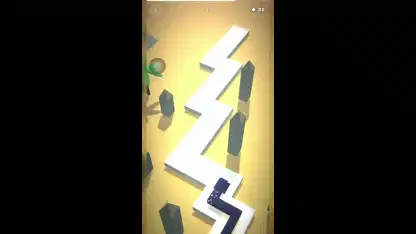

<!-- Generated by scripts/build.py. -->

# ジグザグの道を進むリズムゲーム『Hibiki Trail』

[一覧に戻る](https://github.com/VibeClip/awesome-fable-5-2-videos/blob/main/README.ja.md)

**[▶ 本編](https://video.twimg.com/amplify_video/2121223724628406273/vid/avc1/1080x1920/t3Zo4quBpWwRSnxb.mp4?tag=29)** · [元の投稿](https://x.com/tetumemo/status/2121223780718792936)

[tetumemo](https://x.com/tetumemo) · 0:40 · 2026-11-13

作者はゲームの素材とBGMをFable 5.2で作り、デモの短縮編集にMuseを使ったと説明しています。

[元の投稿](https://x.com/tetumemo/status/2121223784753713165)

## 公開プロンプト

公開プロンプトは未登録です。

出典と確認情報

- モデル表記の根拠: 元の投稿にモデル名の記載あり
- 投稿のアクセス確認日: 2026-11-14 — 投稿にアクセス可能

投稿のアクセス確認と動画生成の再現は別です。生成やレンダリングを独立して再現していません。

[ライセンスとメディアの権利](https://github.com/VibeClip/awesome-fable-5-2-videos/blob/main/docs/MEDIA-RIGHTS.md)

