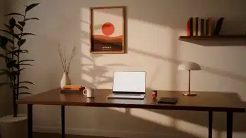

<!-- Generated by scripts/build.py. -->

# 『夜明けまで』Blenderで描いた机の上の物語

[一覧に戻る](https://github.com/VibeClip/awesome-fable-5-2-videos/blob/main/README.ja.md)

**[▶ 本編](https://video.twimg.com/amplify_video/2120640502261575680/vid/avc1/1280x720/k2KorEXRvxHQV80s.mp4?tag=29)** · [元の投稿](https://x.com/toumorocorn_00/status/2120640549543936475)

[toumorocorn_00](https://x.com/toumorocorn_00) · 0:59 · 2026-11-11

作者は『The Edge』を参考に、独自のマスコットと音楽で新しい短編を制作。Fable 5.2がBlenderのスクリプトで部屋、机、人形を作り、音楽にはmuseとSunoを使用しました。

## 公開プロンプト

公開プロンプトは未登録です。

出典と確認情報

- モデル表記の根拠: 元の投稿にモデル名の記載あり
- 投稿のアクセス確認日: 2026-11-14 — 投稿にアクセス可能

投稿のアクセス確認と動画生成の再現は別です。生成やレンダリングを独立して再現していません。

[ライセンスとメディアの権利](https://github.com/VibeClip/awesome-fable-5-2-videos/blob/main/docs/MEDIA-RIGHTS.md)

