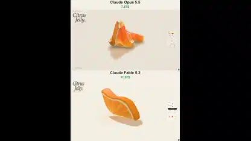

<!-- Generated by scripts/build.py. -->

# オレンジのゼリーを2モデルで比較

[一覧に戻る](https://github.com/VibeClip/awesome-fable-5-2-videos/blob/main/README.ja.md)

**[▶ 本編](https://video.twimg.com/amplify_video/2121646347770015745/vid/avc1/1080x1400/oYsA5ldV906FI0dm.mp4?tag=29)** · [元の投稿](https://x.com/vib3coded/status/2121646685319221546)

[vib3coded](https://x.com/vib3coded) · 0:17 · 2026-11-14

作者は同じ指示でFable 5.2とOpus 5.5を比較。二つのゼリーが変形する様子を並べています。公開プロンプトにはWebGPUとWGSLが指定されています。

## 公開プロンプト

作者が下記のリンクでプロンプトを公開しています。参考素材や追加指示と合わせて元の文脈を確認してください。

[作者の公開プロンプトを読む](https://x.com/vib3coded/status/2121646834611331214)

出典と確認情報

- モデル表記の根拠: 元の投稿にモデル名の記載あり
- 投稿のアクセス確認日: 2026-11-14 — 投稿にアクセス可能

投稿のアクセス確認と動画生成の再現は別です。生成やレンダリングを独立して再現していません。

[ライセンスとメディアの権利](https://github.com/VibeClip/awesome-fable-5-2-videos/blob/main/docs/MEDIA-RIGHTS.md)

