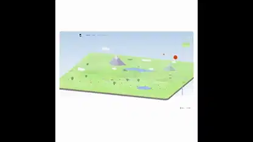

<!-- Generated by scripts/build.py. -->

# ポートフォリオのヘッダーが遊べる小さな島に

[一覧に戻る](https://github.com/VibeClip/awesome-fable-5-2-videos/blob/main/README.ja.md)

**[▶ 本編](https://video.twimg.com/amplify_video/2120683743199301632/vid/avc1/1080x1080/ezd_CzSHH4_ZktKm.mp4?tag=29)** · [元の投稿](https://x.com/willbepan/status/2120683775499575626)

[willbepan](https://x.com/willbepan) · 0:20 · 2026-11-12

作者はFable 5.2で平面のヘッダーを遊べる3Dの島に変えたと説明。俯瞰と、地形に近づいた視点を切り替えています。

## 公開プロンプト

公開プロンプトは未登録です。

出典と確認情報

- モデル表記の根拠: 元の投稿にモデル名の記載あり
- 投稿のアクセス確認日: 2026-11-15 — 投稿にアクセス可能

投稿のアクセス確認と動画生成の再現は別です。生成やレンダリングを独立して再現していません。

[ライセンスとメディアの権利](https://github.com/VibeClip/awesome-fable-5-2-videos/blob/main/docs/MEDIA-RIGHTS.md)

