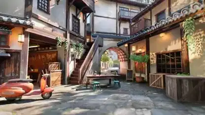

<!-- Generated by scripts/build.py. -->

# Three.jsで巡る三つのイラスト調の屋内空間

[一覧に戻る](https://github.com/VibeClip/awesome-fable-5-2-videos/blob/main/README.ja.md)

**[▶ 本編](https://video.twimg.com/amplify_video/2120947168924364800/vid/avc1/1920x1080/zq1_KKLKIQD1OmZX.mp4?tag=29)** · [元の投稿](https://x.com/XRarchitect/status/2120947265007440052)

[XRarchitect](https://x.com/XRarchitect) · 0:21 · 2026-11-12

作者はAtlas、Fable 5.2、Three.jsを使用。明るい中庭から暖色に照らされた室内まで、異なる空間をカメラが巡ります。

## 公開プロンプト

公開プロンプトは未登録です。

出典と確認情報

- モデル表記の根拠: 元の投稿にモデル名の記載あり
- 投稿のアクセス確認日: 2026-11-14 — 投稿にアクセス可能

投稿のアクセス確認と動画生成の再現は別です。生成やレンダリングを独立して再現していません。

[ライセンスとメディアの権利](https://github.com/VibeClip/awesome-fable-5-2-videos/blob/main/docs/MEDIA-RIGHTS.md)

