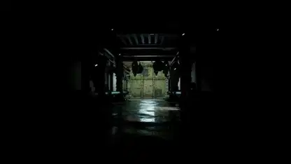

<!-- Generated by scripts/build.py. -->

# 랜턴 거미

[모음으로 돌아가기](https://github.com/VibeClip/awesome-fable-5-2-videos/blob/main/README.ko.md)

**[▶ 전체 영상](https://video.twimg.com/amplify_video/2122065027339329536/vid/avc1/2580x1080/TXi8bpetSDYDKLzz.mp4?tag=29)** · [원본 게시물](https://x.com/aGim_asf/status/2122065184743153882)

[aGim_asf](https://x.com/aGim_asf) · 1:03 · 2026-11-15

제작자는 GPT 이미지와 Tripo로 에셋을 준비하고 Fable 5.2로 Blender의 리그, 숏, 애니메이션을 스크립트로 구성했다. 답글에 전체 흐름, 프롬프트, 음원 출처가 있다.

[원본 게시물](https://x.com/aGim_asf/status/2122065188325122269)

## 공개 프롬프트

창작자가 아래 링크에서 프롬프트를 공유했습니다. 참고 자료와 추가 지시를 포함한 원래 맥락을 확인하세요.

[창작자의 공개 프롬프트 보기](https://x.com/aGim_asf/status/2122065188325122269)

출처 및 확인 정보

- 모델 표기의 근거: 원본 게시물에 모델명 명시
- 게시물 접근 확인 날짜: 2026-11-16 — 게시물 접근 가능

게시물 접근 확인과 영상 생성 재현은 별개입니다. 생성 및 렌더링 과정은 독립적으로 재현하지 않았습니다.

[라이선스 및 미디어 권리](https://github.com/VibeClip/awesome-fable-5-2-videos/blob/main/docs/MEDIA-RIGHTS.md)

