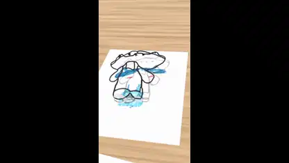

<!-- Generated by scripts/build.py. -->

# 손그림의 선이 실이 되어 캐릭터를 다시 짜는 영상

[모음으로 돌아가기](https://github.com/VibeClip/awesome-fable-5-2-videos/blob/main/README.ko.md)

**[▶ 전체 영상](https://video.twimg.com/amplify_video/2121888732135788544/vid/avc1/1080x1920/T6MRHBPf7hXe_aPh.mp4?tag=29)** · [원본 게시물](https://x.com/akiyoshisan/status/2121890007237722501)

[akiyoshisan](https://x.com/akiyoshisan) · 1:08 · 2026-11-15

제작자는 Fable 5.2가 OpenCV로 손그림에서 선을 추출하고 Python으로 Blender를 구동해 렌더링했다고 밝혔습니다. 음악은 직접 녹음한 베이스를 바탕으로 일부를 Suno로 늘렸습니다.

## 공개 프롬프트

창작자가 공유한 원문입니다. 맥락과 필요한 입력 자료는 원본을 참고하세요.

> 手描きの線そのものを立体にして

[창작자의 공개 프롬프트 보기](https://x.com/akiyoshisan/status/2121890007237722501)

출처 및 확인 정보

- 모델 표기의 근거: 원본 게시물에 모델명 명시
- 게시물 접근 확인 날짜: 2026-11-15 — 게시물 접근 가능

게시물 접근 확인과 영상 생성 재현은 별개입니다. 생성 및 렌더링 과정은 독립적으로 재현하지 않았습니다.

[라이선스 및 미디어 권리](https://github.com/VibeClip/awesome-fable-5-2-videos/blob/main/docs/MEDIA-RIGHTS.md)

