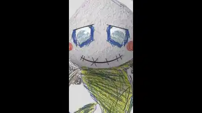

<!-- Generated by scripts/build.py. -->

# 꿰매어진 입

[모음으로 돌아가기](https://github.com/VibeClip/awesome-fable-5-2-videos/blob/main/README.ko.md)

**[▶ 전체 영상](https://video.twimg.com/amplify_video/2122969942878564352/vid/avc1/320x568/6ePWZHP5RN8fjeCS.mp4?tag=29)** · [원본 게시물](https://x.com/akiyoshisan/status/2122970728492646854)

[akiyoshisan](https://x.com/akiyoshisan) · 0:42 · 2026-11-18

Fable 5.2가 Python과 Blender로 원화를 움직였으며 Suno로 제작자의 베이스 녹음을 늘렸다.

## 공개 프롬프트

창작자가 공유한 원문입니다. 맥락과 필요한 입력 자료는 원본을 참고하세요.

> 顔に芝居をさせて！

[창작자의 공개 프롬프트 보기](https://x.com/akiyoshisan/status/2122970728492646854)

출처 및 확인 정보

- 모델 표기의 근거: 원본 게시물에 모델명 명시
- 게시물 접근 확인 날짜: 2026-11-21 — 게시물 접근 가능

게시물 접근 확인과 영상 생성 재현은 별개입니다. 생성 및 렌더링 과정은 독립적으로 재현하지 않았습니다.

[라이선스 및 미디어 권리](https://github.com/VibeClip/awesome-fable-5-2-videos/blob/main/docs/MEDIA-RIGHTS.md)

