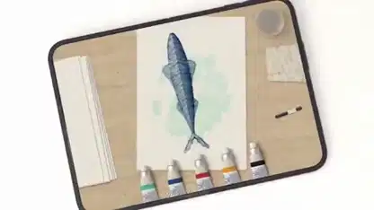

<!-- Generated by scripts/build.py. -->

# 접이식 화면용 수채화 앱 데모

[모음으로 돌아가기](https://github.com/VibeClip/awesome-fable-5-2-videos/blob/main/README.ko.md)

**[▶ 전체 영상](https://video.twimg.com/amplify_video/2120301806248984576/vid/avc1/960x540/SPRHR2g2Wawm3bva.mp4?tag=29)** · [원본 게시물](https://x.com/anshuc/status/2120301850532499927)

[anshuc](https://x.com/anshuc) · 1:07 · 2026-11-10

제작자는 접는 각도를 활용하는 앱의 제작과 촬영을 Fable 5.2에 맡기고 디자인 및 영상 스킬을 제공했다. 이후 직접 수정한 부분도 밝혔다.

[원본 게시물](https://x.com/anshuc/status/2120301853825024054)

## 공개 프롬프트

창작자가 아래 링크에서 프롬프트를 공유했습니다. 참고 자료와 추가 지시를 포함한 원래 맥락을 확인하세요.

[창작자의 공개 프롬프트 보기](https://x.com/anshuc/status/2120301853825024054)

출처 및 확인 정보

- 모델 표기의 근거: 원본 게시물에 모델명 명시
- 게시물 접근 확인 날짜: 2026-11-16 — 게시물 접근 가능

게시물 접근 확인과 영상 생성 재현은 별개입니다. 생성 및 렌더링 과정은 독립적으로 재현하지 않았습니다.

[라이선스 및 미디어 권리](https://github.com/VibeClip/awesome-fable-5-2-videos/blob/main/docs/MEDIA-RIGHTS.md)

