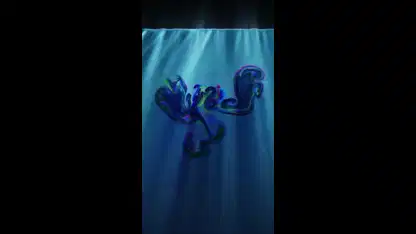

<!-- Generated by scripts/build.py. -->

# 물에 떨어진 기름으로 이야기를 그린 추상 단편

[모음으로 돌아가기](https://github.com/VibeClip/awesome-fable-5-2-videos/blob/main/README.ko.md)

**[▶ 전체 영상](https://video.twimg.com/amplify_video/2120214452507115520/vid/avc1/1080x1920/C_n2LMgpQ5ZWqwdh.mp4?tag=29)** · [원본 게시물](https://x.com/aollivier82/status/2120324378521116962)

[aollivier82](https://x.com/aollivier82) · 0:32 · 2026-11-11

제작자는 Fable 5.2에 물에 떨어지는 기름의 효과로 이야기를 만들도록 요청했습니다. 세로 단편은 빛과 색이 바뀌면서 장면을 연결합니다. 렌더링 과정은 공개되지 않았습니다.

## 공개 프롬프트

등록된 공개 프롬프트가 없습니다.

출처 및 확인 정보

- 모델 표기의 근거: 원본 게시물에 모델명 명시
- 게시물 접근 확인 날짜: 2026-11-14 — 게시물 접근 가능

게시물 접근 확인과 영상 생성 재현은 별개입니다. 생성 및 렌더링 과정은 독립적으로 재현하지 않았습니다.

[라이선스 및 미디어 권리](https://github.com/VibeClip/awesome-fable-5-2-videos/blob/main/docs/MEDIA-RIGHTS.md)

