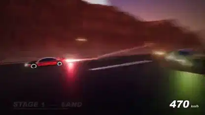

<!-- Generated by scripts/build.py. -->

# ElevenLabs 음악에 맞춘 슈퍼카 곡예 레이스

[모음으로 돌아가기](https://github.com/VibeClip/awesome-fable-5-2-videos/blob/main/README.ko.md)

**[▶ 전체 영상](https://video.twimg.com/amplify_video/2120135695037837313/vid/avc1/1920x1080/yXrA_ezGd_Frjbvw.mp4?tag=29)** · [원본 게시물](https://x.com/challenger_ND/status/2120149476057006186)

[challenger_ND](https://x.com/challenger_ND) · 0:30 · 2026-11-10

제작자는 Fable 5.2에 ElevenLabs 음악에 맞춰 경주 영상을 코드로 만들라고 요청했습니다. 자동차는 여러 환경에서 공중 회전과 드리프트를 합니다.

## 공개 프롬프트

등록된 공개 프롬프트가 없습니다.

출처 및 확인 정보

- 모델 표기의 근거: 원본 게시물에 모델명 명시
- 게시물 접근 확인 날짜: 2026-11-15 — 게시물 접근 가능

게시물 접근 확인과 영상 생성 재현은 별개입니다. 생성 및 렌더링 과정은 독립적으로 재현하지 않았습니다.

[라이선스 및 미디어 권리](https://github.com/VibeClip/awesome-fable-5-2-videos/blob/main/docs/MEDIA-RIGHTS.md)

