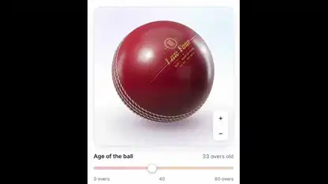

<!-- Generated by scripts/build.py. -->

# 크리켓 공 인터랙티브 렌더링

[모음으로 돌아가기](https://github.com/VibeClip/awesome-fable-5-2-videos/blob/main/README.ko.md)

**[▶ 전체 영상](https://video.twimg.com/amplify_video/2120079222689697792/vid/avc1/1206x1464/ZMBtfuAAUuCSN6CZ.mp4?tag=29)** · [원본 게시물](https://x.com/deedydas/status/2120079288372494782)

[deedydas](https://x.com/deedydas) · 0:18 · 2026-11-10

제작자는 원본 게시물에서 Fable 5.2를 언급했다. 렌더러는 공개하지 않았다.

## 공개 프롬프트

등록된 공개 프롬프트가 없습니다.

출처 및 확인 정보

- 모델 표기의 근거: 원본 게시물에 모델명 명시
- 게시물 접근 확인 날짜: 2026-11-16 — 게시물 접근 가능

게시물 접근 확인과 영상 생성 재현은 별개입니다. 생성 및 렌더링 과정은 독립적으로 재현하지 않았습니다.

[라이선스 및 미디어 권리](https://github.com/VibeClip/awesome-fable-5-2-videos/blob/main/docs/MEDIA-RIGHTS.md)

