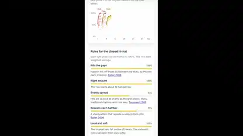

<!-- Generated by scripts/build.py. -->

# 생성한 패턴을 조합한 하우스 음악

[모음으로 돌아가기](https://github.com/VibeClip/awesome-fable-5-2-videos/blob/main/README.ko.md)

**[▶ 전체 영상](https://video.twimg.com/amplify_video/2120904570314305536/vid/avc1/1206x2266/8g60h4oMlWzSL0mh.mp4?tag=29)** · [원본 게시물](https://x.com/deedydas/status/2120905625852936318)

[deedydas](https://x.com/deedydas) · 5:51 · 2026-11-12

제작자는 Fable 5.2가 악기별 패턴을 시도하고 고른 패턴을 하우스 곡으로 편곡했다고 밝혔습니다. 원본 영상에는 음악과 편곡 화면이 담겼습니다.

[원본 게시물](https://x.com/deedydas/status/2120905629459992996)

## 공개 프롬프트

등록된 공개 프롬프트가 없습니다.

출처 및 확인 정보

- 모델 표기의 근거: 원본 게시물에 모델명 명시
- 게시물 접근 확인 날짜: 2026-11-15 — 게시물 접근 가능

게시물 접근 확인과 영상 생성 재현은 별개입니다. 생성 및 렌더링 과정은 독립적으로 재현하지 않았습니다.

[라이선스 및 미디어 권리](https://github.com/VibeClip/awesome-fable-5-2-videos/blob/main/docs/MEDIA-RIGHTS.md)

