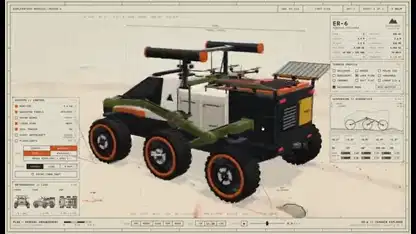

<!-- Generated by scripts/build.py. -->

# 험지 주행 로버 서스펜션 시뮬레이터

[모음으로 돌아가기](https://github.com/VibeClip/awesome-fable-5-2-videos/blob/main/README.ko.md)

**[▶ 전체 영상](https://video.twimg.com/amplify_video/2120558575387131905/vid/avc1/3456x1990/D5saQ1Xn1-2_bXLA.mp4?tag=29)** · [원본 게시물](https://x.com/DilumSanjaya/status/2120561077385867663)

[DilumSanjaya](https://x.com/DilumSanjaya) · 1:22 · 2026-11-11

제작자는 Fable 5.2에 로커-보기 차량의 설계와 험지 주행 시뮬레이션을 요청했습니다. 영상은 여러 각도에서 바퀴의 움직임을 보여 주며 원본 게시물에 체험판이 있습니다.

## 공개 프롬프트

등록된 공개 프롬프트가 없습니다.

출처 및 확인 정보

- 모델 표기의 근거: 원본 게시물에 모델명 명시
- 게시물 접근 확인 날짜: 2026-11-14 — 게시물 접근 가능

게시물 접근 확인과 영상 생성 재현은 별개입니다. 생성 및 렌더링 과정은 독립적으로 재현하지 않았습니다.

[라이선스 및 미디어 권리](https://github.com/VibeClip/awesome-fable-5-2-videos/blob/main/docs/MEDIA-RIGHTS.md)

