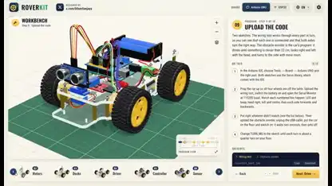

<!-- Generated by scripts/build.py. -->

# 〈RoverKit〉 대화형 로봇 조립 가이드

[모음으로 돌아가기](https://github.com/VibeClip/awesome-fable-5-2-videos/blob/main/README.ko.md)

**[▶ 전체 영상](https://video.twimg.com/amplify_video/2121283445456588800/vid/avc1/3456x1990/uBZhtusJ-gGu4i86.mp4?tag=29)** · [원본 게시물](https://x.com/DilumSanjaya/status/2121286147393651085)

[DilumSanjaya](https://x.com/DilumSanjaya) · 1:46 · 2026-11-13

제작자는 Fable 5.2로 앱을 만들었다고 밝혔습니다. 영상은 3D 조립 가이드, 시각적인 코드 해설, 코스를 바꿀 수 있는 주행 시뮬레이터를 차례로 보여 줍니다.

[원본 게시물](https://x.com/DilumSanjaya/status/2121286149910220854)

## 공개 프롬프트

등록된 공개 프롬프트가 없습니다.

출처 및 확인 정보

- 모델 표기의 근거: 원본 게시물에 모델명 명시
- 게시물 접근 확인 날짜: 2026-11-14 — 게시물 접근 가능

게시물 접근 확인과 영상 생성 재현은 별개입니다. 생성 및 렌더링 과정은 독립적으로 재현하지 않았습니다.

[라이선스 및 미디어 권리](https://github.com/VibeClip/awesome-fable-5-2-videos/blob/main/docs/MEDIA-RIGHTS.md)

