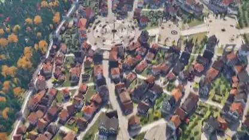

<!-- Generated by scripts/build.py. -->

# 지붕 위부터 거리까지 둘러보는 3D 마을

[모음으로 돌아가기](https://github.com/VibeClip/awesome-fable-5-2-videos/blob/main/README.ko.md)

**[▶ 전체 영상](https://video.twimg.com/amplify_video/2120059143515987968/vid/avc1/2560x1440/T0fkZZHKry2zwcnM.mp4?tag=29)** · [원본 게시물](https://x.com/eluchocha/status/2120059951485698350)

[eluchocha](https://x.com/eluchocha) · 0:59 · 2026-11-10

제작자는 Fable 5.2로 마을을 만들고 에셋은 Blender에서 제작했다고 밝혔습니다. 영상은 지붕 위에서 시작해 거리 높이로 내려갑니다.

## 공개 프롬프트

등록된 공개 프롬프트가 없습니다.

출처 및 확인 정보

- 모델 표기의 근거: 원본 게시물에 모델명 명시
- 게시물 접근 확인 날짜: 2026-11-14 — 게시물 접근 가능

게시물 접근 확인과 영상 생성 재현은 별개입니다. 생성 및 렌더링 과정은 독립적으로 재현하지 않았습니다.

[라이선스 및 미디어 권리](https://github.com/VibeClip/awesome-fable-5-2-videos/blob/main/docs/MEDIA-RIGHTS.md)

