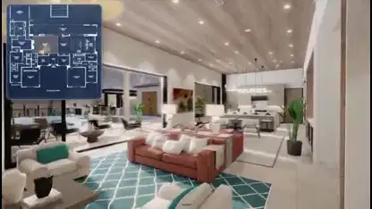

<!-- Generated by scripts/build.py. -->

# 평면도에서 가구가 놓인 집의 3D 투어로

[모음으로 돌아가기](https://github.com/VibeClip/awesome-fable-5-2-videos/blob/main/README.ko.md)

**[▶ 전체 영상](https://video.twimg.com/amplify_video/2120175906501345281/vid/avc1/1902x1080/bf_XglfsEta4QCXA.mp4?tag=16)** · [원본 게시물](https://x.com/everestchris6/status/2120175941616128277)

[everestchris6](https://x.com/everestchris6) · 0:10 · 2026-11-10

제작자는 Fable 5.2로 평면도를 3D 투어로 만들었다고 밝혔습니다. 가구가 놓인 방을 이동하는 동안 화면 한쪽에 평면도가 표시됩니다.

## 공개 프롬프트

등록된 공개 프롬프트가 없습니다.

출처 및 확인 정보

- 모델 표기의 근거: 원본 게시물에 모델명 명시
- 게시물 접근 확인 날짜: 2026-11-15 — 게시물 접근 가능

게시물 접근 확인과 영상 생성 재현은 별개입니다. 생성 및 렌더링 과정은 독립적으로 재현하지 않았습니다.

[라이선스 및 미디어 권리](https://github.com/VibeClip/awesome-fable-5-2-videos/blob/main/docs/MEDIA-RIGHTS.md)

