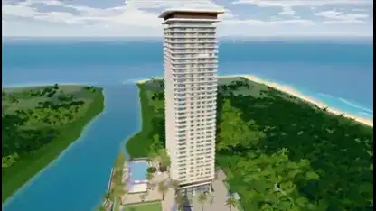

<!-- Generated by scripts/build.py. -->

# Three.js로 고층 타워 외관에서 실내까지 둘러보는 영상

[모음으로 돌아가기](https://github.com/VibeClip/awesome-fable-5-2-videos/blob/main/README.ko.md)

**[▶ 전체 영상](https://video.twimg.com/amplify_video/2120939561715163137/vid/avc1/1898x1080/jxemZtOQ1szTzU7-.mp4?tag=16)** · [원본 게시물](https://x.com/everestchris6/status/2120939600504074444)

[everestchris6](https://x.com/everestchris6) · 0:16 · 2026-11-12

제작자는 평면도 투어에 Fable 5.2와 Three.js를 사용했다고 밝혔습니다. 수변의 고층 건물을 보여 준 뒤 곡선 창이 있는 실내로 들어갑니다.

## 공개 프롬프트

등록된 공개 프롬프트가 없습니다.

출처 및 확인 정보

- 모델 표기의 근거: 원본 게시물에 모델명 명시
- 게시물 접근 확인 날짜: 2026-11-15 — 게시물 접근 가능

게시물 접근 확인과 영상 생성 재현은 별개입니다. 생성 및 렌더링 과정은 독립적으로 재현하지 않았습니다.

[라이선스 및 미디어 권리](https://github.com/VibeClip/awesome-fable-5-2-videos/blob/main/docs/MEDIA-RIGHTS.md)

