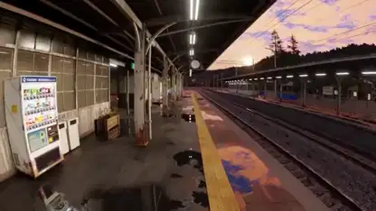

<!-- Generated by scripts/build.py. -->

# 낡은 기차역 승강장 걷기

[모음으로 돌아가기](https://github.com/VibeClip/awesome-fable-5-2-videos/blob/main/README.ko.md)

**[▶ 전체 영상](https://video.twimg.com/amplify_video/2121942981351714816/vid/avc1/640x360/50pJIeMh5deyN_oI.mp4?tag=16)** · [원본 게시물](https://x.com/hayashimon1/status/2121943011525624151)

[hayashimon1](https://x.com/hayashimon1) · 0:15 · 2026-11-15

제작자는 Fable 5.2가 Blender MCP와 코드로 모델링부터 렌더링까지 진행했다고 밝혔다.

## 공개 프롬프트

등록된 공개 프롬프트가 없습니다.

출처 및 확인 정보

- 모델 표기의 근거: 원본 게시물에 모델명 명시
- 게시물 접근 확인 날짜: 2026-11-24 — 게시물 접근 가능

게시물 접근 확인과 영상 생성 재현은 별개입니다. 생성 및 렌더링 과정은 독립적으로 재현하지 않았습니다.

[라이선스 및 미디어 권리](https://github.com/VibeClip/awesome-fable-5-2-videos/blob/main/docs/MEDIA-RIGHTS.md)

