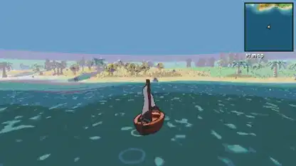

<!-- Generated by scripts/build.py. -->

# 전투 애니메이션을 더한 섬 게임 데모

[모음으로 돌아가기](https://github.com/VibeClip/awesome-fable-5-2-videos/blob/main/README.ko.md)

**[▶ 전체 영상](https://video.twimg.com/amplify_video/2120339686040158208/vid/avc1/1920x1080/-d4odGYaB3R0mUbK.mp4?tag=29)** · [원본 게시물](https://x.com/hyphenholdings/status/2120340122461753345)

[hyphenholdings](https://x.com/hyphenholdings) · 1:05 · 2026-11-11

제작자는 이번 업데이트의 회피와 연계기 등 전투 동작을 Fable 5.2로 만들었다고 밝혔습니다. 영상에는 물에서 섬으로 이동하는 장면이 나오며, 답글에 체험판 링크가 있습니다.

[원본 게시물](https://x.com/hyphenholdings/status/2120340296504643866)

## 공개 프롬프트

등록된 공개 프롬프트가 없습니다.

출처 및 확인 정보

- 모델 표기의 근거: 원본 게시물에 모델명 명시
- 게시물 접근 확인 날짜: 2026-11-15 — 게시물 접근 가능

게시물 접근 확인과 영상 생성 재현은 별개입니다. 생성 및 렌더링 과정은 독립적으로 재현하지 않았습니다.

[라이선스 및 미디어 권리](https://github.com/VibeClip/awesome-fable-5-2-videos/blob/main/docs/MEDIA-RIGHTS.md)

