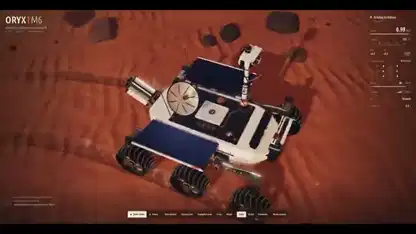

<!-- Generated by scripts/build.py. -->

# Three.js로 주행하는 화성 탐사차

[모음으로 돌아가기](https://github.com/VibeClip/awesome-fable-5-2-videos/blob/main/README.ko.md)

**[▶ 전체 영상](https://video.twimg.com/amplify_video/2121298507961159680/vid/avc1/1280x720/nhXcrFt9DK3QepWN.mp4?tag=29)** · [원본 게시물](https://x.com/ikowwy/status/2121298628556013995)

[ikowwy](https://x.com/ikowwy) · 1:40 · 2026-11-13

제작자는 Fable 5.2와 병렬 에이전트로 Three.js 탐사차를 만들었으며 외부 3D 모델을 가져오지 않았다고 밝혔다.

## 공개 프롬프트

등록된 공개 프롬프트가 없습니다.

출처 및 확인 정보

- 모델 표기의 근거: 원본 게시물에 모델명 명시
- 게시물 접근 확인 날짜: 2026-11-16 — 게시물 접근 가능

게시물 접근 확인과 영상 생성 재현은 별개입니다. 생성 및 렌더링 과정은 독립적으로 재현하지 않았습니다.

[라이선스 및 미디어 권리](https://github.com/VibeClip/awesome-fable-5-2-videos/blob/main/docs/MEDIA-RIGHTS.md)

