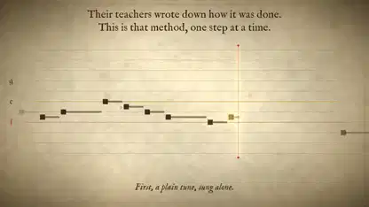

<!-- Generated by scripts/build.py. -->

# 르네상스 4성부 대위법 시각화

[모음으로 돌아가기](https://github.com/VibeClip/awesome-fable-5-2-videos/blob/main/README.ko.md)

**[▶ 전체 영상](https://video.twimg.com/amplify_video/2120668579783737344/vid/avc1/1920x1080/hHADTwaLDxu_Ufzz.mp4?tag=29)** · [원본 게시물](https://x.com/imjustnewatai/status/2120668771119726698)

[imjustnewatai](https://x.com/imjustnewatai) · 1:54 · 2026-11-12

제작자는 Fable 5.2에 15세기 작곡가들이 총보 없이 4성부 대위법을 쓰던 방식을 재현해 적용하도록 요청했습니다. 게시물에는 요청의 요지가 담겨 있습니다.

## 공개 프롬프트

등록된 공개 프롬프트가 없습니다.

출처 및 확인 정보

- 모델 표기의 근거: 원본 게시물에 모델명 명시
- 게시물 접근 확인 날짜: 2026-11-13 — 게시물 접근 가능

게시물 접근 확인과 영상 생성 재현은 별개입니다. 생성 및 렌더링 과정은 독립적으로 재현하지 않았습니다.

[라이선스 및 미디어 권리](https://github.com/VibeClip/awesome-fable-5-2-videos/blob/main/docs/MEDIA-RIGHTS.md)

